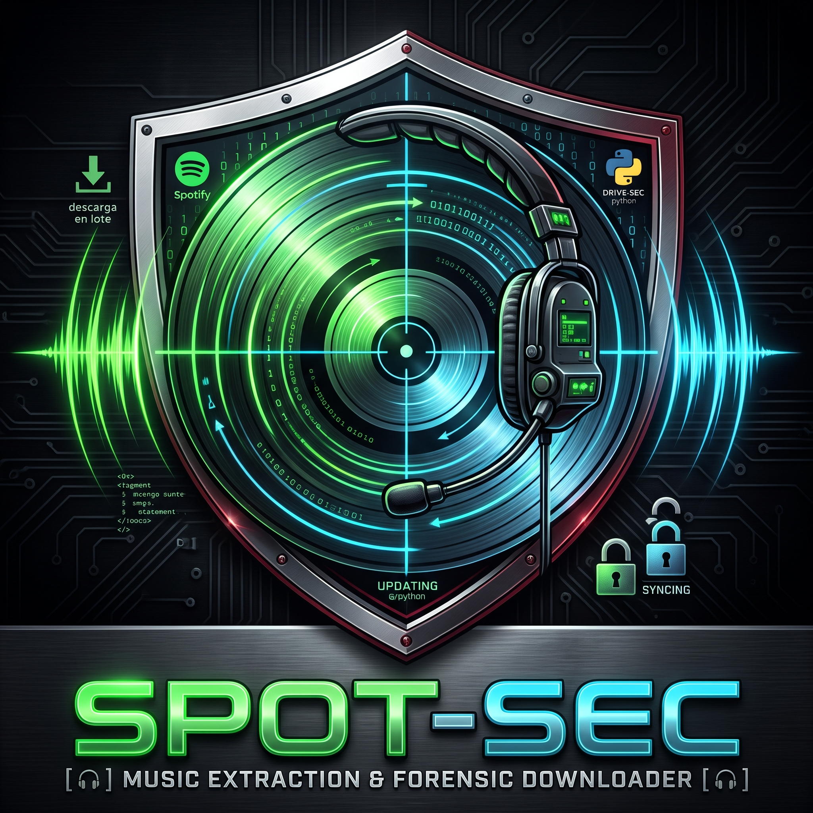

<div align="center">

# Spot-Sec 🎧



**Interfaz gráfica estilo terminal para descargar playlists, álbumes y canciones de Spotify usando [spotDL](https://github.com/spotDL/spotify-downloader).**

Pega enlaces de Spotify o escribe títulos, elige formato e hilos, y Spot-Sec descarga la lista completa mostrando el progreso y un registro de todo lo que pasa.

Hecho con Python + [CustomTkinter](https://github.com/TomSchimansky/CustomTkinter).

</div>

---

## Características

- **Lista de objetivos**: enlaces de Spotify (playlists, álbumes, canciones) o títulos escritos a mano, uno por línea. Un contador te dice cuántos enlaces y cuántos títulos hay.
- **Opciones en pantalla**: formato (`m4a`, `mp3`, `flac`, `opus`, `ogg`, `wav`) y número de hilos (1, 2, 4 u 8).
- **Progreso**: barra de progreso por objetivo (animada cuando solo hay uno), con contadores de objetivo actual, canciones descargadas y fallos.
- **Cancelación**: el botón **Cancelar** detiene la descarga en curso; lo que no se procesó queda en la lista.
- **Reintento manual**: los objetivos que fallan, o que quedaron pendientes, vuelven a la caja de texto para volver a intentarlos.
- **Registro con colores**: verde para éxitos, rojo para errores, ámbar para avisos, azul para información. Se puede limpiar y guardar en un `.txt`.
- **Subcarpeta automática** por playlist o álbum dentro de la carpeta de destino.
- **Comodidades**: botones para pegar y vaciar la lista, abrir la carpeta de destino y atajo `Ctrl+Enter` para iniciar.
- **Seguro**: los comandos se ejecutan como lista de argumentos, sin `shell=True`. Al cerrar la ventana se detiene el proceso de spotDL en curso.

## Requisitos

- Python 3.10 o superior
- Tkinter (viene con Python en Windows y con el instalador oficial en macOS; en Linux hay que instalarlo)
- [spotDL](https://github.com/spotDL/spotify-downloader) y [CustomTkinter](https://github.com/TomSchimansky/CustomTkinter) (se instalan con `requirements.txt`)
- [ffmpeg](https://ffmpeg.org/) (spotDL puede descargarlo por ti)
- Git, si vas a clonar el repositorio (si no, descarga el ZIP desde GitHub)

## Instalación

### Linux (Debian / Ubuntu / Kali)

Estas distribuciones protegen el Python del sistema (PEP 668), así que usa un entorno virtual:

```bash
git clone https://github.com/MRVYP3R/spot-sec.git
cd spot-sec

sudo apt install python3-full python3-tk
python3 -m venv venv
source venv/bin/activate

pip install -r requirements.txt
spotdl --download-ffmpeg        # o: sudo apt install ffmpeg
```

### Windows

En **CMD** o **PowerShell**:

```powershell
git clone https://github.com/MRVYP3R/spot-sec.git
cd spot-sec

python -m venv venv
venv\Scripts\activate

pip install -r requirements.txt
spotdl --download-ffmpeg
```

> Si PowerShell bloquea la activación del entorno virtual, ejecuta una vez
> `Set-ExecutionPolicy -Scope CurrentUser RemoteSigned` y vuelve a intentar, o usa CMD.

### macOS

```bash
git clone https://github.com/MRVYP3R/spot-sec.git
cd spot-sec

python3 -m venv venv
source venv/bin/activate

pip install -r requirements.txt
spotdl --download-ffmpeg
```

> Si instalaste Python con Homebrew y falta Tkinter: `brew install python-tk`.

## Uso

Activa el entorno virtual y ejecuta el script. Debe estar activado siempre, porque el programa busca `spotdl` dentro de él.

```bash
# Linux / macOS
source venv/bin/activate
python3 spotsec5.py
```

```powershell
# Windows
venv\Scripts\activate
python spotsec5.py
```

1. Elige la carpeta de destino (por defecto, `spotify_volcado` junto al script).
2. Pega tus enlaces o títulos en la caja, **uno por línea**.
3. Elige formato e hilos.
4. Pulsa **Iniciar descarga** (o `Ctrl+Enter`).

### Ejemplo de lista

```text
https://open.spotify.com/playlist/37i9dQZF1DXcBWIGoYBM5M
https://open.spotify.com/album/1DFixLWuPkv3KT3TnV35m3
https://open.spotify.com/track/4uLU6hMCjMI75M1A2tKUQC
Artista - Nombre de la canción
```

### Opciones

| Opción | Descripción |
|---|---|
| Carpeta de destino | Dónde se guardan las descargas. Dentro se crea una subcarpeta por playlist o álbum |
| Formato | `m4a`, `mp3`, `flac`, `opus`, `ogg`, `wav` |
| Hilos | Descargas simultáneas: 1, 2, 4 u 8 |

## Credenciales de Spotify (opcional, recomendado)

Sin credenciales propias, spotDL usa las compartidas y es fácil toparse con límites de peticiones. Para evitarlo:

1. Entra a <https://developer.spotify.com/dashboard> y crea una app gratuita.
2. Copia el **Client ID** y el **Client Secret**.
3. Pégalos en las constantes `SPOTIFY_CLIENT_ID` y `SPOTIFY_CLIENT_SECRET` al inicio de `spotsec5.py`.

> ⚠️ El Client Secret queda en texto plano dentro del script. No subas tu copia con las credenciales a ningún repositorio.

## Solución de problemas

| Problema | Solución |
|---|---|
| `ModuleNotFoundError: No module named 'customtkinter'` | No activaste el entorno virtual o no corriste `pip install -r requirements.txt` |
| `No se encontró 'spotdl' en el PATH` | Activa el entorno virtual antes de ejecutar el script, o instala con `pip install -U spotdl` |
| `externally-managed-environment` al usar pip | Usa un entorno virtual (ver instalación). Evita `--break-system-packages` |
| `No module named 'tkinter'` | Linux: `sudo apt install python3-tk`. macOS con Homebrew: `brew install python-tk` |
| spotDL no encuentra ffmpeg | Ejecuta `spotdl --download-ffmpeg` o instala ffmpeg desde tu gestor de paquetes |
| Errores de límite de peticiones | Configura tu propio Client ID y Client Secret |
| Dejó de funcionar de un día para otro | Actualiza spotDL con `pip install -U spotdl`: YouTube cambia a menudo y spotDL necesita actualizarse |

## Cómo funciona

Spot-Sec es una capa de interfaz sobre spotDL: lee tu lista, ejecuta `spotdl download` para cada objetivo en un hilo aparte y analiza su salida para mostrar el progreso y los resultados.

## Aviso legal

Esta herramienta es un proyecto personal y **no está afiliada a Spotify ni a YouTube**. spotDL obtiene el audio desde fuentes de terceros, y descargar música protegida por derechos de autor puede infringir la ley o los términos de servicio de esas plataformas según tu país. Úsala solo con contenido que tengas derecho a descargar y bajo tu propia responsabilidad.

## Licencia

Distribuido bajo la licencia [MIT](LICENSE): puedes usar, copiar, modificar y compartir este proyecto libremente, incluso con fines comerciales, siempre que conserves el aviso de copyright y la licencia.
